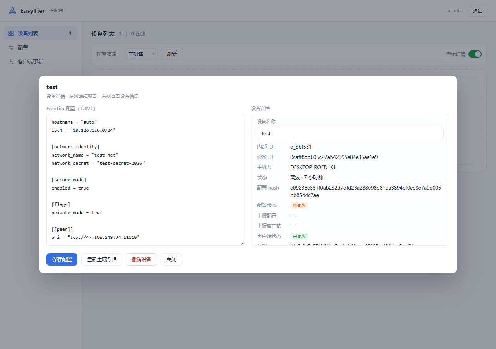

# mesh-server

EasyTier 控制面：设备台账、配置下发、客户端发布与心跳判定。单文件静态二进制，状态全部落在 `DATA_DIR`。

- 接口契约：[`../docs/`](../docs/)
- 实现与部署：[`DESIGN.md`](./DESIGN.md)

## 开发

```bash
just check        # gofmt + go vet + go test + 前端类型检查
just build        # 交叉编译 linux/amd64 与 linux/arm64 到 .dist/
just run          # 本地起一份，DATA_DIR=.data，PORT=8080
```

前端在 `frontend/`：`pnpm dev` 起 Vite（`/api` 代理到 127.0.0.1:8088），`pnpm build` 产出 `frontend/dist`，
再由根目录 `web.go` 的 `//go:embed all:frontend/dist` 打进二进制。

Windows 上跑 `just` 需要一个 bash（Git Bash 即可），`stop` 等 recipe 依赖 Linux 的 `ss`/`/proc`。

## 部署参考

两样东西描述同一套部署：`k8s.mesh-server.yaml` 是 podman 的 pod 清单，`mesh-rpc.socket` /
`mesh-rpc.service` 是宿主上的 systemd 单元。签发通道要两头对齐——清单里
`ET_RPC_SOCKET=/run/mesh/rpc.sock` 加一个 `/run/mesh` 的 hostPath 挂载，宿主上由
`mesh-rpc.socket` 创建这个文件、`systemd-socket-proxyd` 把连接转给 `127.0.0.1:15888`。

| 文件 | 作用 |
| --- | --- |
| `mesh-rpc.socket` | 监听 `/run/mesh/rpc.sock`，`SocketMode=0600` |
| `mesh-rpc.service` | 把该 socket 上的连接转给 EasyTier 的 loopback RPC |

`SocketUser` 要换成容器内 root 映射到的宿主账号：rootless podman 下容器 root 就是运行
podman 的那个用户，换成别人会导致容器连不上。这份单元不含任何秘密，`15888` 是 EasyTier
的默认 RPC 端口。
## 控制台


