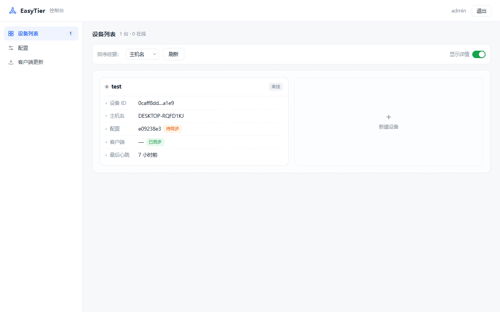

# mesh-server

EasyTier 控制面：设备台账、配置下发、客户端发布与心跳判定。单文件静态二进制，状态全部落在 `DATA_DIR`。

- 接口契约：[`../CONTRACT.md`](../CONTRACT.md) 第 1 节
- 实现与部署：[`DESIGN.md`](./DESIGN.md)

## 开发

```bash
just check        # gofmt + go vet + go test + 前端类型检查
just build        # 交叉编译 linux/amd64 与 linux/arm64 到 .dist/
just run          # 本地起一份，DATA_DIR=.data，PORT=8080
```

前端在 `frontend/`：`pnpm dev` 起 Vite（`/api` 代理到 127.0.0.1:8088），`pnpm build` 产出 `frontend/dist`，
再由根目录 `web.go` 的 `//go:embed all:frontend/dist` 打进二进制。

Windows 上跑 `just` 需要一个 bash（Git Bash 即可），`stop` 等 recipe 依赖 Linux 的 `ss`/`/proc`。

## 控制台



