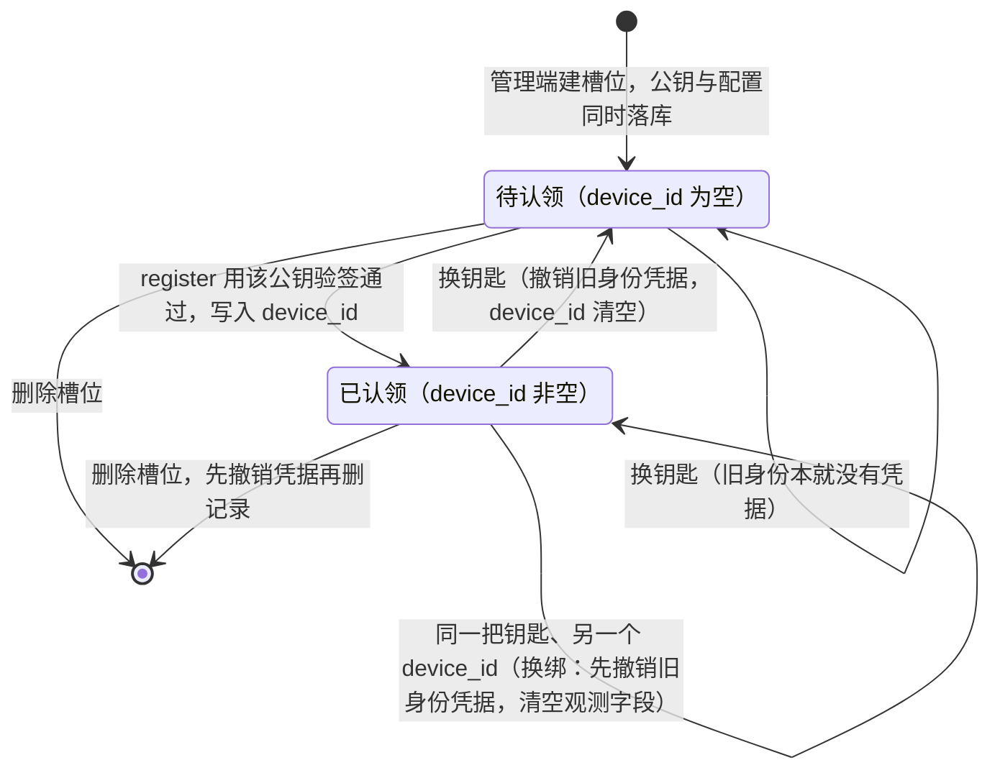
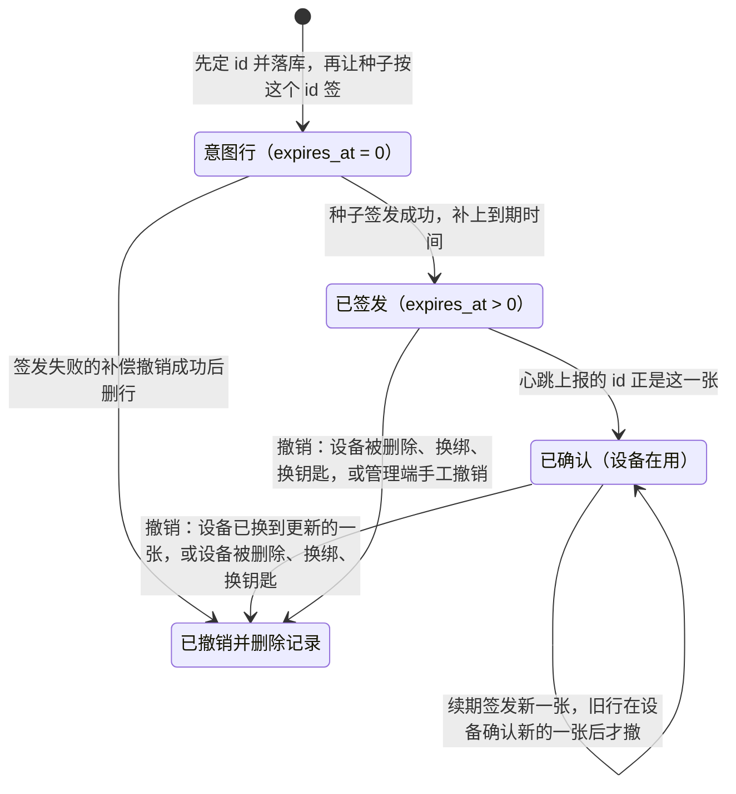
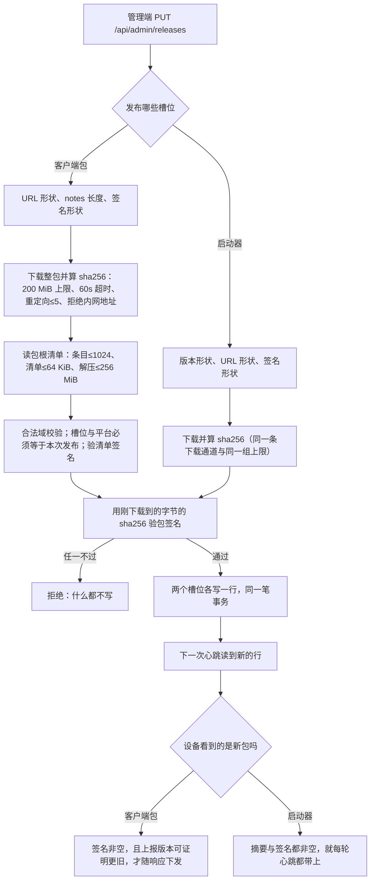
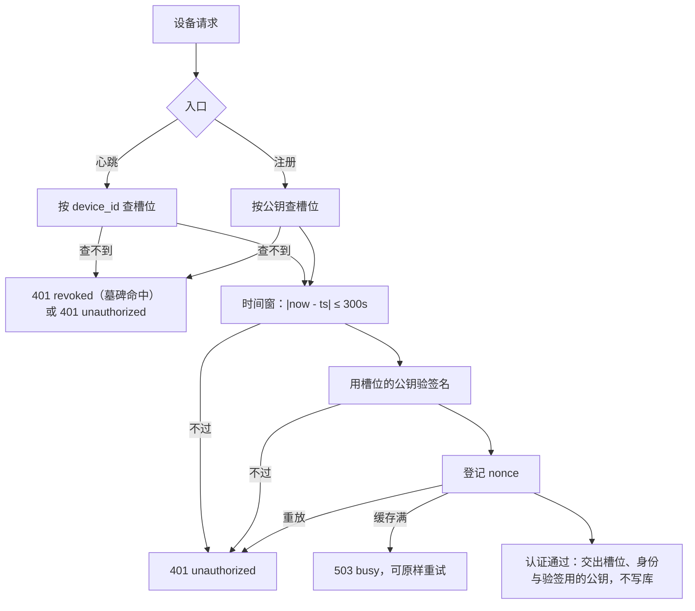
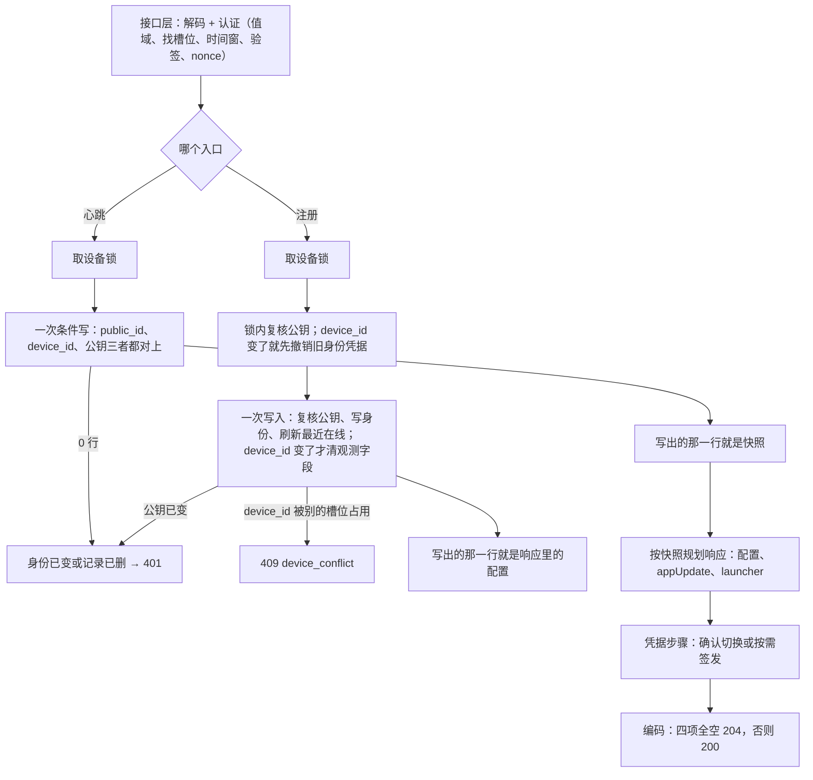
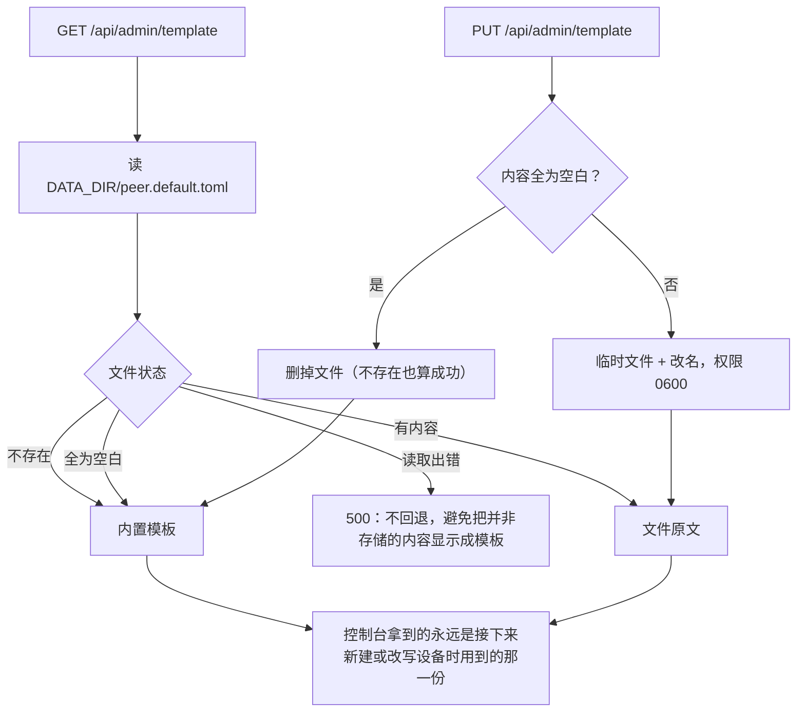

# 控制面状态模型

本文只写控制面的**状态空间**：有哪些状态、谁能进入、允许的迁移、跨状态必须成立的不变量。线格式与字段不在这里重复，见 [契约/device-api.md](../../docs/contract/device-api.md)（设备面 HTTP、请求签名、校验顺序、凭据签发）、[契约/admin-api.md](../../docs/contract/admin-api.md)（管理面、设备级覆盖）与 [契约/updates.md](../../docs/contract/updates.md)（槽位、版本比较、下发条件）。

本文覆盖六个模型：槽位生命周期、凭据生命周期、发布流程、请求验签判定顺序、设备面入口的内部推进、默认模板的存取。不覆盖：线格式与字段（见上述契约），以及管理面板前端的呈现。

## 1. 槽位生命周期

一台设备在库里是一行 `device`。它的身份是**公钥**：注册请求只能靠这把钥匙找到槽位（包括还没被认领的那个），`device_id` 是客户端在认领时提交、之后可以换绑的名字。生命周期只有两个真状态——待认领与已认领——在线/离线是派生值，没有禁用之类的第三态。

| 对外状态 | 判定 | 谁能推进它 |
| --- | --- | --- |
| `pending` | `device_id` 为空 | 建槽位即进入；只有成功的注册能离开 |
| `online` | 已认领，且距最近在线不足 90s | 任何通过验签的设备请求：心跳，或注册时的认领写入 |
| `offline` | 已认领，且超出 90s 窗口 | 纯派生：没有写入，只是时间过去 |
| 已删除 | 记录不存在；`device_id` 命中内存墓碑 | 管理端删除、换钥匙（旧 `device_id` 进墓碑） |

心跳是唯一写观测值（最近配置摘要、最近上报版本、上报平台）的入口：它在一次写入里同时刷新最近在线、来源地址与这三个观测值，再按写出的那一行决定配置、更新与凭据的下发。注册只写身份字段（`device_id`、主机名、最近在线、来源地址）；它只在身份变化时把那三个观测值清空，从不写入。

规则：

1. 建槽位必须带公钥：base64 的 32 字节，且能换算成曲线上的 X25519 公钥（凭据按它封装）。公钥已被别的槽位占用即拒绝（`pubkey_in_use`）；槽位总数上限 200。
2. 注册按公钥查槽位：请求里没有别的句柄能找到「还没被认领的那个槽位」。验签用槽位自己的公钥，因此签名证明的是「调用方持有这个槽位的钥匙」，不是「它记得某个名字」。
3. 认领在一次事务里写完：锁内复核公钥未变，写入 `device_id`、主机名、最近在线与来源地址。槽位属性（名称、分组、位置、配置）不动。
4. 换绑（同一把钥匙、另一个 `device_id`）不需要额外证明：签名已经证明了钥匙，而钥匙就是这个槽位。旧身份的观测字段与新身份在同一次写入里清空。
5. 换钥匙：先撤销该槽位名下全部凭据，再清空 `device_id`、主机名与观测字段，槽位回到待认领；旧 `device_id` 进墓碑，之后的签名请求回 `revoked`。撤销失败就整次不换。
6. 删除：先撤销该槽位名下全部凭据，再删记录；撤销失败则删除失败。旧 `device_id` 进墓碑。
7. `device_id` 已被别的槽位占用时，认领回 409 `device_conflict`，槽位记录保持原状。认领（换了 `device_id` 时）与换钥匙都是先撤销旧凭据、再写记录，所以被冲突拒绝时旧凭据可能已经撤销——记录不变，凭据没了。
8. 删除与换钥匙都在设备锁内进行；同一台设备的凭据动作（签发、确认、撤销）排在同一把锁后面。

不变量：

1. 状态是派生值：`pending`/`online`/`offline` 都不落库，由 `device_id` 与最近在线算出。
2. `device_id` 为空与 `pending` 互为定义；一个 `device_id`、一把公钥各自最多属于一个槽位（两个部分唯一索引）。
3. 槽位属性（名称、分组、位置、配置）属于记录，认领与换绑都不改；观测字段属于身份，身份一变就在同一次写入里清空。
4. 公钥是槽位的身份：注册按它查行、验签用它，换钥匙等于换身份，凭据随旧身份一并撤销。
5. 删除与换钥匙的顺序都是先撤销凭据、再改记录；撤销失败则记录不变，客户端可以重试。
6. 墓碑只在进程内存里，重启后退化为 `unauthorized`：客户端不能假设 `revoked` 一定会出现。
7. 观测是一次带 `device_id` 与公钥两个条件的写入，与设备锁一起构成一致性边界：认证之后发生换绑或删除，这次请求什么都不写。

## 2. 凭据生命周期

凭据有两个层面：库里的一行记录（只有 id 与两个时间），与设备身上那张私钥（只在签发响应里出现一次）。记录的状态决定能否撤销，设备的状态决定能否换下一张。

| 设备上报的 `credentialId` | 控制面动作 | 库里的记录 |
| --- | --- | --- |
| 空串（正式节点，或还没上报该字段的客户端） | 既不确认也不签发 | 不变 |
| `none`（本地没有凭据） | 冷却外签发一张 | 新增意图行，签发后补到期时间 |
| 有值，等于最新签发的那张 | 确认切换，撤销其余各行；剩余有效期不足 7 天则续签 | 其余行删除；续签时新增一行 |
| 有值，但不是最新那张 | 冷却外补签一张（设备可能还在重启 core） | 新增一行；旧行保留 |
| 有值，但记录里查不到这一行 | 那张已被撤销或删除，立即签发一张（不适用冷却） | 新增一行；查不到的那行本就不存在 |
| 这台设备从未签发过 | 直接签发一张 | 新增一行 |

「设备正在使用的那一张」由心跳上报值确定，不由「最新签发的」推定：只有上报值命中最新一行，才确认切换并撤销其余行。这正是要区分「已签发」与「已确认」的原因——签发完成后设备还没重启 core，此时撤销旧行会让正在用的那张当场失效。

不变量：

1. 私钥只在签发响应里出现一次：不落库、不写日志，之后服务端只剩 id。
2. 顺序固定为「先记意图、再签发、最后补到期时间」：种子上存在的 id 总有本地记录可撤，签发成功而落库失败也不留下无人知晓的凭据。
3. 只撤销「最新一张以外」的行；未确认之前不动设备正在用的那张。
4. 撤销幂等（种子上没有这张也算成功），失败则不删记录，留下重试材料。
5. 冷却 5 分钟只作用于两档（报 `none`、报库里还有的旧 id）；续期与「报一张已被删除的 id」不受它限制——后者每轮都会命中，但设备拿到新凭据后就会改报新的那张，冷却只会把一次删除拖成五分钟掉线。
6. 正式节点不签发：判据与控制台显示同源，配置读不出来时拒绝签发而不是当成凭据节点。
7. 设备名下全部凭据的撤销共用一个总时限（30s），不随凭据张数线性增长。
8. 到期不自动删行：行只在被撤销时消失（确认切换、换绑、换钥匙、删除设备、管理端撤销），到期时间只用于续期判断。

## 3. 发布流程

一次发布分三段：**校验**（含下载）、**落库**、**对设备可见**。前两段构成提交边界，第三段不在其中——它由下一次心跳决定。

| 槽位状态 | 判定 | 设备看到的 |
| --- | --- | --- |
| 未发布 | 该槽位的行不存在 | 响应里不带该字段 |
| 已发布但不满足下发条件 | 客户端包行的签名为空；启动器行缺摘要或签名；设备上报的版本不比发布版本旧 | 不带该字段，继续用手里那份 |
| 已发布且满足下发条件 | 签名与摘要齐全，且版本可证明更旧 | 心跳响应里带完整 offer |

原子性边界只有一处：写两个槽位的那一笔事务。校验阶段不写任何东西，所以被拒的请求连槽位都不会碰；一次请求带两个槽位时，要么都写、要么都不写。

跨请求不原子：两次发布各自独立，一个成功一个失败是允许的。清空也分粒度：一个入口删掉该平台两个槽位的行，另一个只删启动器那一行。

设备看到的仍是旧包，只有下列几种原因：

1. 该平台没有发布记录，或设备上报的平台与记录的 `platform` 不同。
2. 客户端包行的 `signature` 为空：加签名之前的旧记录按「未发布」处理。
3. 启动器缺摘要或签名：同样按「未发布」处理，避免每 30 秒下发一个必然被拒的槽位。
4. 设备上报的版本不比发布版本旧（回滚过发布、手工装过更新的包），或版本号不可排序：只要求升级，不要求降级。
5. 设备还没到下一次心跳：offer 只在心跳响应里更新，两次心跳之间手里仍是上一份。

版本方向只有一条豁免：从没上报过版本的设备按「更旧」处理，会拿到 offer——它在装上之后立刻就会报出自己的版本，不会形成循环。

不变量：

1. 控制面不产生签名，只验证：签名是发布的输入，服务器自己签只会证明它签了自己的下载。
2. 验签覆盖控制面刚下载到的那些字节的摘要，不覆盖管理端填写的摘要。
3. 发布失败不写任何槽位：全部下载与验签在落库之前完成。
4. 槽位独立更新：发布客户端包不动启动器那一行，反之亦然。
5. 槽位的行只在该槽位已发布时存在：发布插入或覆盖该行，清空删除该行；不存在描述未发布槽位的行。
6. 设备只会被要求升级：版本比较只在「可证明更旧」时成立。

## 4. 请求验签判定顺序

设备请求的认证只有一个入口：请求体里的 `deviceId`、`timestamp`、`nonce`、`signature`。两条设备面入口的判定顺序不同：心跳按 `device_id` 找槽位，注册按公钥找槽位，`device_id` 反而是它要写进去的值。逐步的落状态见 [契约/device-api.md](../../docs/contract/device-api.md)「校验顺序」，这里只补每一步失败之后落下什么。

| 步骤 | 心跳 | 注册 | 落下的状态 |
| --- | --- | --- | --- |
| 0 字段合法域 | 401 `unauthorized` | 400 `invalid_request`（主机名超长同此）；公钥形状不对另回 400 `invalid_pubkey` | 无：不读库、不写库 |
| 1 槽位存在 | 按 `device_id` 查；查不到 → 401 `revoked`（墓碑命中）或 401 `unauthorized` | 按公钥查；同上 | 无：认证只读，不刷新最近在线 |
| 2 时间窗 | \|now − ts\| ≤ 300s，不过 → 401 | 同 | 无：nonce 不被登记 |
| 3 签名 | 用槽位公钥验签，不过 → 401 | 同 | 无：nonce 不被登记 |
| 4 nonce 登记 | 窗口内未用过；重放 → 401；缓存满 → 503 | 同 | 已登记的 nonce 留在内存，至少保留到 max(now, ts) + 300s |
| 之后 业务写入 | 锁内条件写 | 锁内认领 | 身份已变或记录已删：这次请求什么都不写 |

认证通过之后，状态推进才真正发生：心跳在一次条件写入里刷新最近在线与观测字段，并据写入后的那一行决定配置、更新与凭据；注册在一次事务里认领槽位，并把写出的那一行作为响应里的配置。认证本身不写任何持久状态，失败也不会留下痕迹——可观察的副作用只有内存里的 nonce 与墓碑。

不变量：

1. `401` 不泄露失败原因：时钟偏差、nonce 重放与签名错误走同一条响应。
2. 验签先于登记 nonce：一份验不过的签名不该占用 nonce，否则伪造请求能抢先登记合法客户端正在用的 nonce。
3. nonce 缓存有容量上限（8192），满时拒绝新 nonce 而不是驱逐仍在窗口内的条目——驱逐等于让用过的签名重新可用。容量不足是服务端状态，回答 503 而不是 401：把容量问题当成身份失效，会让客户端清掉一个还有效的身份。
4. 认证只读槽位行；任何写都在业务入口的设备锁与条件写之内，不存在「观测已写、响应仍来自旧绑定」的中间态。
5. 请求体是唯一认证入口，没有任何设备请求用请求头认证。
6. `revoked` 只是内存墓碑的投影，不持久化；客户端不能把它当成必然出现的终态。

## 5. 设备面入口的内部推进

认证通过之后，注册与心跳各走一个业务入口，结构相同：取设备锁 → 一次写入 → 以写出的那一行为快照 → 规划响应。注册用快照里的配置作答；心跳据快照规划配置、更新、启动器与凭据。接口层只解码、认证、映射错误与编码，不写设备、不切快照。

| 入口 | 条件写 | 冲突时的回答 |
| --- | --- | --- |
| 心跳 | 一条条件更新：条件带上 `device_id` 与验签用的公钥，同一条语句写最近在线、来源地址与三个观测字段 | 影响 0 行 → 记录已删或身份已变，两者都回 401 |
| 注册 | 一次事务内的条件更新：锁内复核公钥、身份变了就清观测字段、写 `device_id`、主机名、最近在线与来源地址 | 公钥已变 → 401；`device_id` 被别的槽位占用 → 409 |

认领没有「首次绑定」与「换绑」两条路径：它们落在同一处写入上，差别只有 `device_id` 是否变了——变了就先撤销旧身份凭据、并在写入里清空观测字段。因此槽位从待认领进入已认领时不需要额外材料；已认领的槽位回到待认领只有换钥匙一条路，删除是另一种结局。

心跳的响应四项只由快照决定：配置（上报摘要与快照里的配置摘要不同才带）、`appUpdate`（签名非空且版本可证明更旧）、`launcher`（摘要与签名都在就每轮都带）、凭据（凭据步骤的结果）。凭据步骤失败只记日志、不下发，心跳照常回答。

不变量：

1. 认证只读：槽位行的写入只发生在入口的设备锁内。
2. 每次心跳只写一次设备行：最近在线与观测字段在同一条语句里。
3. 响应、更新与凭据决定都来自同一次写入产生的那一行，不存在「观察到 A、回答用 B」。
4. 换绑与删除要么整体落在请求之前或之后；落在中间时这次请求什么都不写，回 401。
5. 认领在同一笔事务里完成复核与写入：认证之后换了钥匙，这次注册什么都不写，回 401。
6. 凭据步骤失败不阻塞心跳：只记日志，下一轮再试。
7. 接口层不写设备、不切快照；它只解码、认证、映射错误与编码。

## 6. 默认模板的存取

模板不是发布工件：它有独立的路由与存储，保存与发布没有共同提交点。唯一事实来源是 `DATA_DIR/peer.default.toml`，内置模板只是回退。

| 模板状态 | 判定 | 新建或改写设备时控制台拿到的是 |
| --- | --- | --- |
| 内置 | 文件不存在，或内容全为空白 | 编进二进制的内置模板 |
| 自定义 | 文件存在且非空白 | 文件原文，占位符原样保留 |
| 读取失败 | 文件存在但读不出来（权限、IO） | 不提供：请求回 500，不回退 |

不变量：

1. 文件是唯一事实来源；内置模板只在文件缺失或全为空白时使用。
2. 空白等于「没有自定义模板」：删文件与「文件缺失」是同一件事，不存在「空模板」这种状态。
3. 读取失败不回退：宁可 500，也不让控制台显示一份并非存储的内容——否则一次保存就会覆盖原文件。
4. 保存是原子的：临时文件加改名，权限 `0600`；失败不改动现有文件。
5. 模板不被设备行引用：控制面只存设备提交的配置原文，改模板不影响已建成的设备，只影响下一次新建或改写时控制台填进去的内容。
6. 模板不是发布工件：发布路由不接收、不保存也不返回它。
7. 占位符由控制台填充，控制面只存原文，不解释、不替换。
