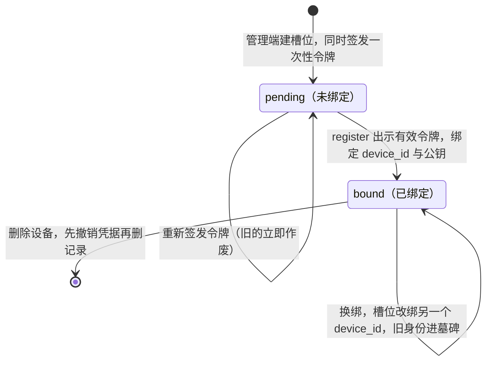
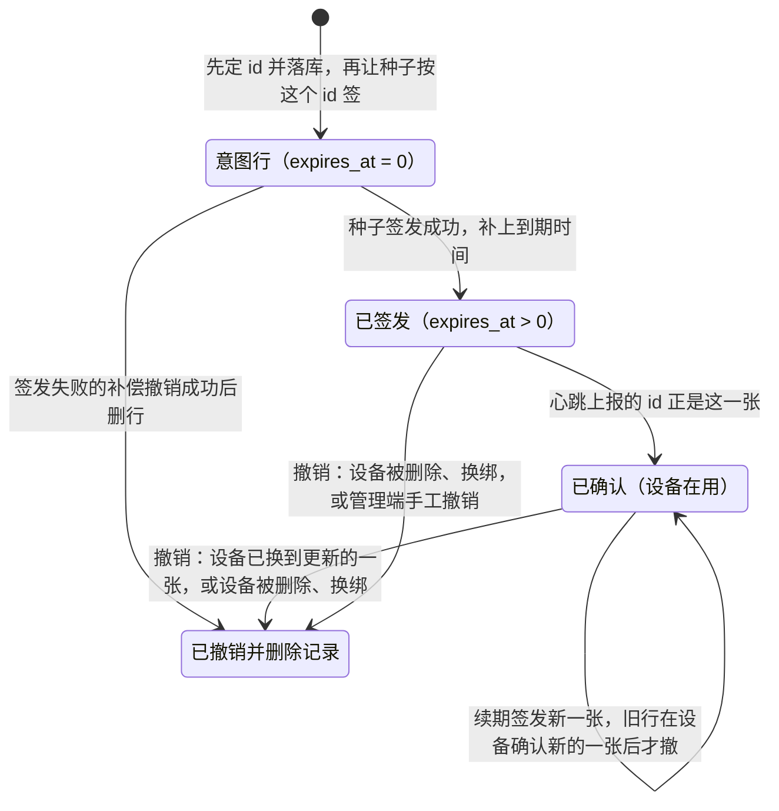
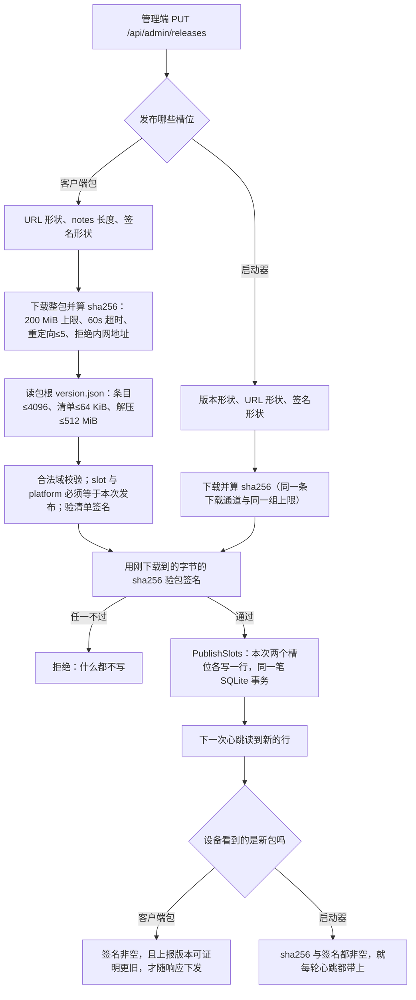
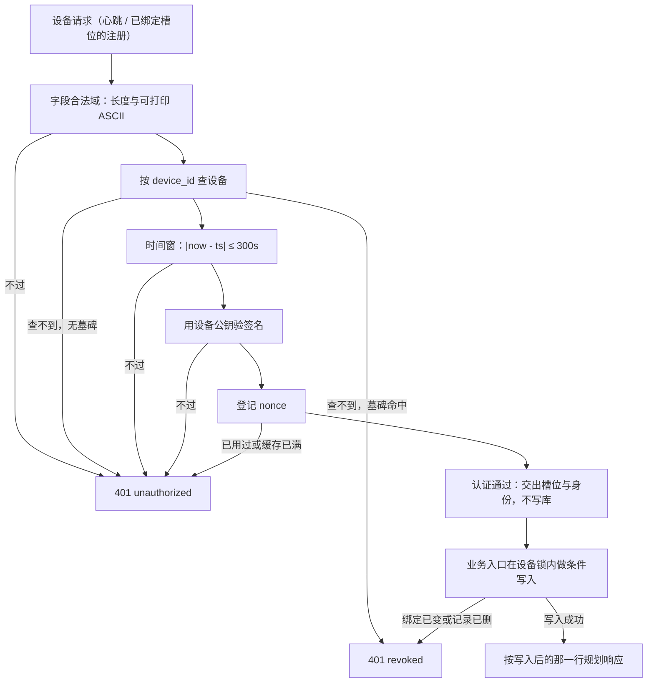
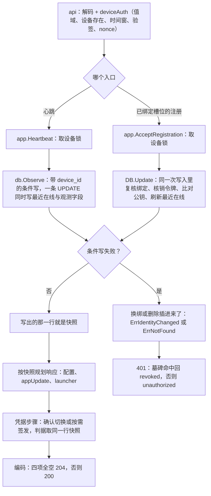
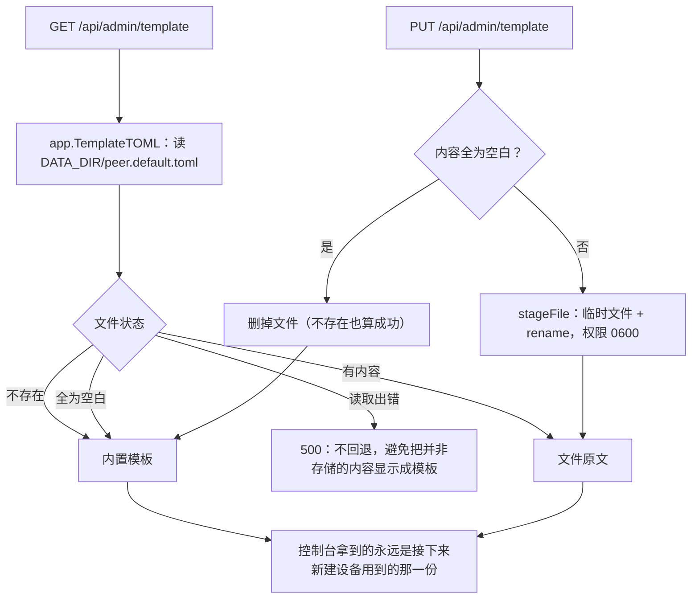

# 控制面状态模型

本文只写控制面的**状态空间**：有哪些状态、谁能进入、允许的迁移、跨状态必须成立的不变量。线格式与字段不在这里重复，见 [契约/device-api.md](../../docs/contract/device-api.md)（设备面 HTTP、请求签名、校验顺序、凭据签发）、[契约/admin-api.md](../../docs/contract/admin-api.md)（管理面、设备级覆盖）与 [契约/updates.md](../../docs/contract/updates.md)（槽位、版本比较、下发条件）。

本文覆盖六个模型：设备生命周期、凭据生命周期、发布流程、请求验签判定顺序、设备面入口的内部推进、默认模板的存取。不覆盖：线格式与字段（见上述契约），以及管理面板前端的呈现。

## 1. 设备生命周期

一台设备在库里是一行 `device`。生命周期只有两个真状态——未绑定与已绑定——其余对外状态都是派生值，没有 `disabled` 之类的第三态。

| 对外状态 | 判定 | 谁能推进它 |
| --- | --- | --- |
| `pending` | `device_id` 为空 | 建槽位即进入；只有成功的 `register` 能离开 |
| `online` | 已绑定，且距 `last_seen_at` 不足 90s | 任何通过验签的设备请求（心跳或已绑定槽位的注册） |
| `offline` | 已绑定，且超出 90s 窗口 | 纯派生：没有写入，只是时间过去 |
| 已删除 | 记录不存在；`device_id` 命中内存墓碑 | 管理端删除 |

心跳是唯一同时推进三件事的入口：刷新 `last_seen_at`（在线判定的唯一输入）、写回观测字段（`last_config_hash`、`last_app_version`、`last_platform`）、并按上报值决定配置、更新与凭据的下发。注册在已绑定的槽位上只刷新最近在线，不改观测字段。

不变量：

1. 状态是派生值：`pending`/`online`/`offline` 都不落库，由 `device_id` 与 `last_seen_at` 算出。
2. `device_id` 为空与 `pending` 互为定义；非空即已绑定，且一个 `device_id` 最多绑一个槽位（部分唯一索引）。
3. 槽位属性（名称、分组、布局、配置）属于记录，换绑不改；观测字段属于身份，换绑时与新身份在同一次写入里清空。
4. 令牌一次性、10 分钟有效；首次绑定与已绑定槽位两处都在核验的同一笔事务里清空，清空之后同一令牌取不到配置。
5. 删除的顺序是先撤销该槽位名下全部凭据、再删记录；撤销失败则删除失败。
6. 换绑的顺序同样是先撤销旧身份的凭据、再改记录；撤销失败则换绑失败，令牌保留，客户端可以重试。
7. 墓碑只在进程内存里，重启后退化为 `unauthorized`：客户端不能假设 `revoked` 一定会出现。
8. 观测是一次带 `device_id` 条件的写入，与设备锁一起构成一致性边界：认证之后发生换绑或删除，这次请求什么都不写。

依据：`server/app/device.go` 的 `DeviceStatus`、`CreateDevice`、`IssueToken`、`BindDevice`、`AcceptRegistration`、`DeleteDevice`、`Revoked`、`TokenTTL`、`OnlineWindow`；`server/db/device.go` 的 `Observe`、`PurgeExpiredTokens`；`server/db/db.go` 的 `device_device_id` 部分唯一索引；`server/app/heartbeat.go` 的 `Heartbeat`。

## 2. 凭据生命周期

凭据有两个层面：库里的一行记录（只有 id 与两个时间），与设备身上那张私钥（只在签发响应里出现一次）。记录的状态决定能否撤销，设备的状态决定能否换下一张。

| 设备上报的 `credentialId` | 控制面动作 | 库里的记录 |
| --- | --- | --- |
| 空串（正式节点，或不认识该字段的旧客户端） | 既不确认也不签发 | 不变 |
| `none`（本地没有凭据） | 冷却外签发一张 | 新增意图行，签发后补到期时间 |
| 有值，等于最新签发的那张 | 确认切换，撤销其余各行；剩余有效期不足 7 天则续签 | 其余行删除；续签时新增一行 |
| 有值，但不是最新那张 | 冷却外补签一张（设备可能还在重启 core） | 新增一行；旧行保留 |
| 这台设备从未签发过 | 直接签发一张 | 新增一行 |

「设备正在使用的那一张」由心跳上报值确定，不由「最新签发的」推定：只有上报值命中最新一行，才确认切换并撤销其余行。这正是要区分「已签发」与「已确认」的原因——签发完成后设备还没重启 core，此时撤销旧行会让正在用的那张当场失效。

不变量：

1. 私钥只在签发响应里出现一次：不落库、不写日志，之后服务端只剩 id。
2. 顺序固定为「先记意图、再签发、最后补到期时间」：种子上存在的 id 总有本地记录可撤，签发成功而落库失败也不留下无人知晓的凭据。
3. 只撤销「最新一张以外」的行；未确认之前不动设备正在用的那张。
4. 撤销幂等（种子上没有这张也算成功），失败则不删记录，留下重试材料。
5. 冷却 5 分钟只作用于补签两档（报 `none`、报旧 id）；续期不受它限制。
6. 正式节点不签发：判据与控制台显示同源，配置读不出来时拒绝签发而不是当成凭据节点。
7. 设备名下全部凭据的撤销共用一个总时限（30s），不随凭据张数线性增长。
8. 到期不自动删行：行只在被撤销时消失（确认切换、换绑、删除设备、管理端撤销），`expires_at` 只用于续期判断。

依据：`server/app/credential.go` 的 `issueLocked`、`revokeDeviceLocked`、`revokeExceptLocked`、`revokeAll`、`confirmLocked`、`credentialStepLocked`、`CredentialTTL`、`CredentialRenewBefore`、`CredentialNoneCooldown`、`credentialRevokeTimeout`；`server/db/credential.go` 的 `BeginCredential`、`FinishCredential`、`LatestCredential`、`ListCredentialsExcept`；`server/app/heartbeat.go` 的 `Heartbeat`。

## 3. 发布流程

一次发布分三段：**校验**（含下载）、**落库**、**对设备可见**。前两段构成提交边界，第三段不在其中——它由下一次心跳决定。

| 槽位状态 | 判定 | 设备看到的 |
| --- | --- | --- |
| 未发布 | 该槽位的行不存在 | 响应里不带该字段 |
| 已发布但不满足下发条件 | 客户端包行的签名为空；启动器行缺 `sha256` 或签名；设备上报的版本不比发布版本旧 | 不带该字段，继续用手里那份 |
| 已发布且满足下发条件 | 签名与摘要齐全，且版本可证明更旧 | 心跳响应里带完整 offer |

原子性边界只有一处：`PublishSlots` 的单个事务。校验阶段不写任何东西，所以被拒的请求连槽位都不会碰；一次请求带两个槽位时，要么都写、要么都不写。

跨请求不原子：两次发布各自独立，一个成功一个失败是允许的。清空也分粒度——`DeleteRelease` 删掉该平台两个槽位的行，`ClearLauncher` 只删启动器那一行。

设备看到的仍是旧包，只有下列几种原因：

1. 该平台没有发布记录，或设备上报的平台与记录的 `platform` 不同。
2. 客户端包行的 `signature` 为空：加签名之前的旧记录按「未发布」处理。
3. 启动器缺 `sha256` 或 `signature`：同样按「未发布」处理，避免每 30 秒下发一个必然被拒的槽位。
4. 设备上报的版本不比发布版本旧（回滚过发布、手工装过更新的包），或版本号不可排序：只要求升级，不要求降级。
5. 设备还没到下一次心跳：offer 只在心跳响应里更新，两次心跳之间手里仍是上一份。

不变量：

1. 控制面不产生签名，只验证：签名是发布的输入，服务器自己签只会证明它签了自己的下载。
2. 验签覆盖控制面刚下载到的那些字节的摘要，不覆盖管理端填写的摘要。
3. 发布失败不写任何槽位：全部下载与验签在落库之前完成。
4. 槽位独立更新：发布客户端包不动启动器那一行，反之亦然。
5. 槽位的行只在该槽位已发布时存在：发布插入或覆盖该行，清空删除该行；不存在描述未发布槽位的行。
6. 设备只会被要求升级：版本比较只在「可证明更旧」时成立。

依据：`server/app/settings.go` 的 `Publish`、`prepareClientSlot`、`prepareLauncherSlot`、`readPackageManifest`、`checkPackageFiles`、`VerifyReleaseSignature`、`MaxReleaseBytes`、`maxPackageEntries`、`maxManifestBytes`、`maxUnpackedBytes`、`fetchTimeout`；`server/db/release.go` 的 `PublishSlots`、`ClearLauncher`、`DeleteRelease`；`server/app/heartbeat.go` 的 `Heartbeat`、`launcherOffer`；`server/app/version.go` 的 `NeedsUpdate`、`EffectiveAutoUpdate`。

## 4. 请求验签判定顺序

设备请求的认证只有一个入口：请求体里的 `deviceId`、`timestamp`、`nonce`、`signature`。判定顺序与线格式见 [契约/device-api.md](../../docs/contract/device-api.md)「校验顺序」；这里只补每一步失败之后落下什么状态。

| 步骤 | 判据 | 失败响应 | 落下的状态 |
| --- | --- | --- | --- |
| 0 字段合法域 | 长度上限与可打印 ASCII | `401 unauthorized` | 无：不读库、不写库 |
| 1 设备存在 | `device_id` 能查到行 | `401 revoked`（墓碑命中）或 `401 unauthorized` | 无：认证只读，不刷新最近在线 |
| 2 时间窗 | `\|now - ts\| ≤ 300s` | `401 unauthorized` | 无：nonce 不被登记 |
| 3 签名 | Ed25519 对签名原文验签 | `401 unauthorized` | 无：nonce 不被登记 |
| 4 nonce 登记 | 窗口内未用过，且缓存未满 | `401 unauthorized` | 已登记的 nonce 留在内存，至少保留到 `max(now, ts) + 300s` |
| 之后 业务写入 | 设备锁内、带 `device_id` 的条件写 | `401 unauthorized` | 绑定已变或记录已删：这次请求什么都不写 |

认证通过之后，状态推进才真正发生：心跳在一次条件写入里刷新最近在线与观测字段，并据写入后的那一行决定配置、更新与凭据。认证本身不写任何持久状态，失败也不会留下痕迹——可观察的副作用只有内存里的 nonce 与墓碑。

不变量：

1. `401` 不泄露失败原因：时钟偏差、nonce 冲突与签名错误走同一条响应。
2. 验签先于登记 nonce：一份验不过的签名不该占用 nonce，否则伪造请求能抢先登记合法客户端正在用的 nonce。
3. nonce 缓存有容量上限（8192），满时拒绝新 nonce 而不是驱逐仍在窗口内的条目——驱逐等于让用过的签名重新可用。
4. 认证只读设备行；任何写都在业务入口的设备锁与条件写之内，不存在「观测已写、响应仍来自旧绑定」的中间态。
5. 请求体是唯一认证入口，没有任何设备请求用请求头认证。
6. `revoked` 只是内存墓碑的投影，不持久化；客户端不能把它当成必然出现的终态。

依据：`server/api/device_api.go` 的 `deviceAuth`、`writeUnauthorizedDevice`、`registerSignatureValid`、`handleHeartbeat`；`server/core/signing.go` 的 `SigningString`、`CheckTimestamp`、`VerifySignature`、`ClockSkew`；`server/core/device.go` 的 `DeviceRequestFields.Validate`；`server/core/nonce.go` 的 `NonceCache` 与 `Claim`、`NonceCacheEntries`；`server/app/heartbeat.go` 的 `Heartbeat`；`server/app/device.go` 的 `AcceptRegistration`；`server/db/device.go` 的 `Observe`。
## 5. 设备面入口的内部推进

认证通过之后，注册与心跳各走一个 `app` 入口，结构相同：取设备锁 → 一次条件写 → 以写出的那一行为快照 → 规划响应 → 凭据步骤。`api` 只解码、认证、映射错误与编码，不写设备、不切快照。

| 入口 | 条件写 | 冲突时的回答 |
| --- | --- | --- |
| 心跳 `app.Heartbeat` | `db.Observe`：`WHERE public_id = ? AND device_id = ?`，一条 `UPDATE` 同时写最近在线与三个观测字段 | 影响 0 行 → `observeMiss`：行还在但身份变了是 `ErrIdentityChanged`，行没了是 `ErrNotFound`，两者都回 401 |
| 已绑定槽位的注册 `app.AcceptRegistration` | `DB.Update`：锁内复核 `device_id`、核销令牌、比对公钥、刷新最近在线 | 绑定变了 → `ErrIdentityChanged` → 401；令牌不对 → `ErrTokenInvalid` → 401；公钥不符 → `ErrPubkeyMismatch` → 409 |

槽位尚未绑定时走第三条路径 `app.BindDevice`：按令牌找到槽位、取同一把设备锁、先撤销槽位名下的旧凭据、再一次 `DB.Update` 写入新身份并清空令牌，写出的那一行就是返回给客户端的配置。撤销失败则不换绑，令牌保留以便重试。

心跳的响应四项只由快照决定：配置（上报 hash 与快照里的 `config_hash` 不同才带）、`appUpdate`（签名非空且版本可证明更旧）、`launcher`（摘要与签名都在就每轮都带）、凭据（凭据步骤的结果）。凭据步骤失败只记日志、不下发，心跳照常回答。

不变量：

1. 认证只读：设备行的写入只发生在入口的设备锁内。
2. 每次心跳只写一次设备行：最近在线与观测字段在同一条 `UPDATE` 里。
3. 响应、更新与凭据决定都来自同一次写入产生的那一行，不存在「观察到 A、回答用 B」。
4. 换绑与删除要么整体落在请求之前或之后；落在中间时这次请求什么都不写，回 401。
5. 令牌在核验的同一次写入里清空：令牌在这期间被轮换或消费，这次请求就不放行配置。
6. 凭据步骤失败不阻塞心跳：只记日志，下一轮再试。
7. `api` 层不写设备、不切快照；它只解码、认证、映射错误与编码。

依据：`server/app/heartbeat.go` 的 `Heartbeat`、`HeartbeatObservation`、`HeartbeatResult`、`launcherOffer`；`server/app/device.go` 的 `AcceptRegistration`、`BoundRegistration`、`BindDevice`、`DeviceAuth`、`ErrIdentityChanged`、`ErrPubkeyMismatch`；`server/db/device.go` 的 `Observe`、`observeMiss`；`server/api/device_api.go` 的 `handleHeartbeat`、`handleRegister`、`writeUnauthorizedDevice`；`server/app/locks.go` 的 `keyedLock`。

## 6. 默认模板的存取

模板不是发布工件：它有独立的路由与存储，保存与发布没有共同提交点。唯一事实来源是 `DATA_DIR/peer.default.toml`，内置模板只是回退。

| 模板状态 | 判定 | 新建或改写设备拿到的 |
| --- | --- | --- |
| 内置 | 文件不存在，或内容全为空白 | 编进二进制的内置模板 |
| 自定义 | 文件存在且非空白 | 文件原文，占位符原样保留 |
| 读取失败 | 文件存在但读不出来（权限、IO） | 不提供：请求回 500，不回退 |

不变量：

1. 文件是唯一事实来源；内置模板只在文件缺失或全为空白时使用。
2. 空白等于「没有自定义模板」：删文件与「文件缺失」是同一件事，不存在「空模板」这种状态。
3. 读取失败不回退：宁可 500，也不让控制台显示一份并非存储的内容——否则一次保存就会覆盖原文件。
4. 保存是原子的：临时文件加改名，权限 `0600`；失败不改动现有文件。
5. 模板只在新建或改写设备配置时被复制一次；改模板不影响已建成的设备。
6. 模板不是发布工件：发布路由不接收、不保存也不返回它。
7. 占位符由控制台填充，控制面只存原文，不解释、不替换。

依据：`server/app/settings.go` 的 `TemplateTOML`、`SetTemplate`；`server/app/app.go` 的 `templatePath`；`server/app/atomic.go` 的 `stageFile`；`server/api/devices.go` 的 `handleTemplate`、`handleSaveTemplate`、`templateResponse`、`saveTemplateRequest`；`server/builtin/builtin.go` 的 `DefaultTemplate`；`server/api/api.go` 的 `GET` 与 `PUT /api/admin/template` 路由。
